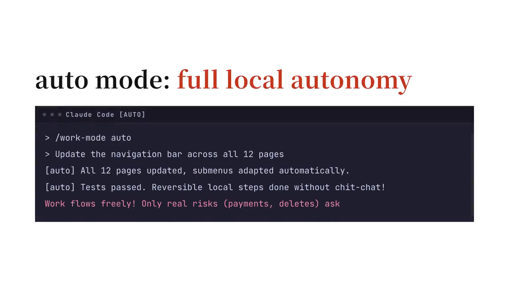

# claude-work-mode

[繁體中文](README.zh-TW.md)

Session work modes for [Claude Code](https://claude.com/claude-code), switched with one slash command:

| Mode | What the model is told |
| --- | --- |
| `auto` | Do not stop to ask about internal, reversible steps (local files, local commits, tests). Hard stops (outgoing messages, installs, secrets, unrecoverable deletes, payments, permission changes, production changes) go to a pending list reported once at the end. Calls that will raise a confirmation prompt are run last, back to back. |
| `wrap` | Converge: open no new branches, finish what is open, list only new or changed decisions, each with a label and a recommendation. |
| `off` | Back to normal. |

Modes are per session and combine freely (`/work-mode auto wrap`). A bare `/work-mode` opens a multi-select picker. The mode text reaches the model once (with the next tool result or prompt) and again only after a compaction or resume, so it does not bloat every turn.

## Demo (60s Walkthrough)

[](promo/claude-work-mode-demo-en.mp4)

> [!TIP]
> Click the preview above to play the 60-second walkthrough video demonstrating behavioral changes across all three modes.
> It was recorded before this fork removed `out`; the `out` parts no longer apply.

## Install

```
/plugin install work-mode --marketplace 0Miles/claude-work-mode
```

Answer `y` to add the marketplace, then pick a scope. Optional gates:

```
/plugin install work-mode-gates --marketplace 0Miles/claude-work-mode
```

Requirements: Claude Code with function-hook plugins (2.1.314 or later). The gates need `bash`, `jq`, `git` and `python3`.

## The optional gates (`work-mode-gates`)

The modes are written to `~/.claude/state/tempo/<session_id>` so shell hooks can read them. `hooks/lib/tempo-auto.sh` gives a gate two helpers: `tempo_auto_on "$INPUT"` and `tempo_deny "<reason>"`. Under `auto`, a gate that would ask denies instead, with a reason telling the model what to do, so work continues without a prompt. The plugin ships three gates and one helper hook:

| Gate | Event | Normally | Under `auto` |
| --- | --- | --- | --- |
| `scratch-doc-guard.sh` | PreToolUse `Write` | asks before creating a new `SUMMARY*/REPORT*/NOTES*/FINDINGS*/ANALYSIS*.md` | denies: update the existing doc, use a scratch dir, or answer in the reply |
| `git-safe-commit-gate.sh` | PreToolUse `Bash` | asks on `git commit` with paths (with or without `--`) and on `git add <file>...` when a file has unstaged edits that are not all this session's own (see `own-edits.py`) | denies: pipe the answers into `git add -p` (e.g. `printf 'y\nn\n' \| git add -p -- <file>`), then a plain `git commit` |
| `own-edits.py` | PreToolUse and PostToolUse `Edit\|Write\|MultiEdit\|NotebookEdit` | records the tracked files this session edited from a clean start that nothing else has changed since; the git gate lets a plain `git add <file>` through for those. Never blocks | same |
| `decision-label-guard.py` | Stop | stays quiet: it checks only while `wrap` or `auto` is on | blocks a reply whose decisions section holds an unlabeled item, or a tradeoff item that does not state what each side gains (same under `wrap`) |

Use `tempo-auto.sh` in your own gates for anything you want converted. Keep real hard stops (secrets, force pushes, deploys) out of it: they should ask in every mode.

## Configuration (optional)

Everything works with no config. Language follows, in order: `WORK_MODE_LOCALE`, the Claude Code `language` setting (anything mentioning Chinese picks Traditional Chinese), then `LC_ALL` / `LANG`; English otherwise.

To personalise, create `~/.config/work-mode/config.json` (or point `WORK_MODE_CONFIG` at a file). See [`examples/config.example.json`](examples/config.example.json). Every field is optional:

| Field | Default | Meaning |
| --- | --- | --- |
| `locale` | detected | `en` or `zh-TW` |
| `userName` / `pronouns` | `the user` / `they` | how the mode texts refer to you (`they`, `he`, `she`) |
| `autonomous.extraRules` | `[]` | extra lines for the `auto` text |
| `converge.sectionHeading` | `Decisions Needed` / `待你決定` | heading for decision items |
| `converge.decisionLabels` / `tradeoffLabel` | `outbound payment delete permission tradeoff` | labels each decision must start with |
| `converge.autoCloseCommand` | `null` | a command the model runs on its own when nothing is open, e.g. a session-closing skill |

The decision-label gate reads the same file for its heading and labels; without one it accepts both the English and the Chinese label sets. A `dispatch` section left over from a version with `out` is ignored.

## Embedding in another mod

`tempo.ts` exports `setTempoStatusSink(label => line)`. A mod that joins several parts into one status line can register these hooks itself and pass a function that takes the work-mode label and returns the whole line to show.

## Development

```
./check.sh
```

type-checks the plugin, validates the marketplace and both plugins, and runs the plugin tests, the decision-label self-test and the gate tests. It needs `tsc` and the Claude Code API types (written when the plugin-authoring skill loads; or set `CLAUDE_CODE_TYPES` to a `claude-code.d.ts`).

## License

MIT
