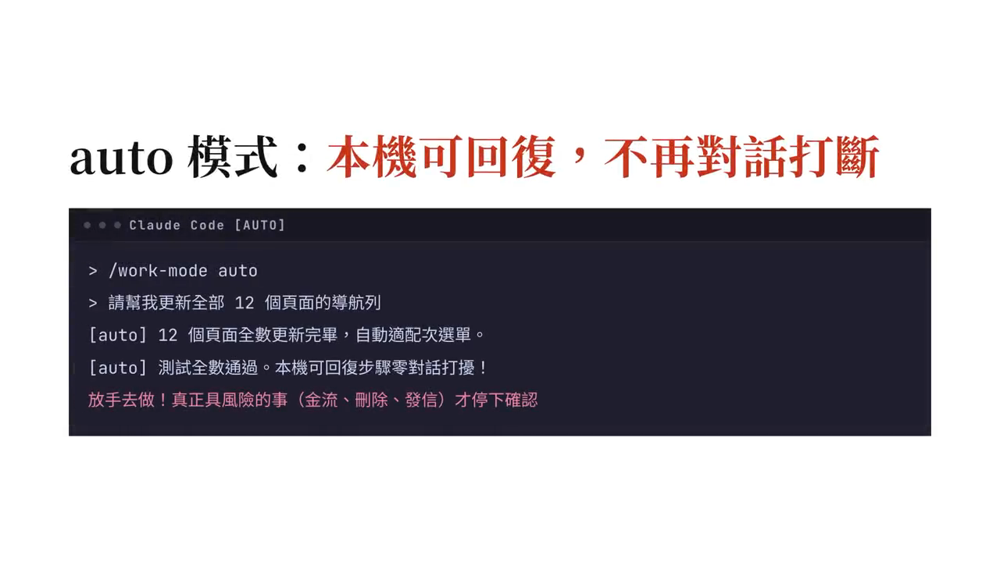

# claude-work-mode

[English](README.md)

給 [Claude Code](https://claude.com/claude-code) 用的工作模式，一個斜線指令切換：

| 指令 | 模型會被告知什麼 |
| --- | --- |
| `/work-mode auto` | 本機、可回復的步驟（改檔、本地 commit、跑測試）不中途停下來問。不擴大範圍：不開新方向，把手上的做完；途中發現的範圍外工作開成 GitHub issue（開在 repo 自己的 `origin`，不開到上游），不動手做。真正要你點頭的事（對外發訊、安裝套件、碰憑證、刪掉救不回的資料、金流、改權限、動正式環境）列在回覆最後的待決區塊，每項帶類別標籤與建議，只列新增或狀態有變的；會跳確認視窗的指令留到最後一口氣跑完，你只被打斷一次。 |
| `/work-mode off` | 回到平常。 |

模式只對當前 session 有效。只打 `/work-mode` 會跳出選單。模式說明只送給模型一次（跟著下一個工具結果或下一則訊息），壓縮或 resume 之後才再送，不會每回合都塞進上下文。

## 示範影片（60 秒快速導覽）

[](promo/claude-work-mode-demo-zh.mp4)

> [!TIP]
> 點擊上方預覽圖即可播放 60 秒完整操作示範影片，包含三種模式的行為改變與痛點對照。
> 影片錄於這個 fork 移除 `out`、把 `wrap` 併進 `auto` 之前，片中這些部分已不適用。

## 安裝

```
/plugin install work-mode --marketplace 0Miles/claude-work-mode
```

詢問是否加入 marketplace 時回 `y`，再選安裝範圍。選裝閘門：

```
/plugin install work-mode-gates --marketplace 0Miles/claude-work-mode
```

需求：支援 function hooks 的 Claude Code（2.1.314 以後）。閘門需要 `bash`、`jq`、`git`、`python3`。

## 選裝閘門（`work-mode-gates`）

模式會寫進 `~/.claude/state/tempo/<session_id>`，讓 shell hook 讀得到。`hooks/lib/tempo-auto.sh` 提供兩個函式：`tempo_auto_on "$INPUT"` 與 `tempo_deny "<理由>"`。開 `auto` 時，原本會「詢問」的閘門改成「拒絕並附上該怎麼做」，模型照著改做法就能繼續，不必停下來等你。內附三個閘門和一個輔助 hook：

| 閘門 | 事件 | 平常 | `auto` 下 |
| --- | --- | --- | --- |
| `scratch-doc-guard.sh` | PreToolUse `Write` | 新建 `SUMMARY*/REPORT*/NOTES*/FINDINGS*/ANALYSIS*.md` 前先問 | 拒絕：改寫進既有文件、放暫存資料夾，或直接寫在回覆裡 |
| `git-safe-commit-gate.sh` | PreToolUse `Bash` | `git commit` 帶路徑（不論有沒有 `--`），或 `git add <檔>...` 而某檔有未 stage、且不全是這個 session 自己改的修改時先問（見 `own-edits.py`） | 拒絕：用管線把答案餵給 `git add -p`（例如 `printf 'y\nn\n' \| git add -p -- <檔>`），再用不帶路徑的 `git commit` |
| `own-edits.py` | PreToolUse 與 PostToolUse `Edit\|Write\|MultiEdit\|NotebookEdit` | 記下這個 session 從乾淨狀態開始改、之後沒被別人動過的已追蹤檔案；這些檔 git 閘門會放行一般的 `git add <檔>`。不會擋任何操作 | 相同 |
| `decision-label-guard.py` | Stop | 不檢查：只在 `auto` 開著時才檢查 | 回覆的待決區塊裡有沒標類別的項目，或「取捨」項目沒講兩邊各自得失，就擋下 |

自己寫的閘門也可以引用 `tempo-auto.sh`。真正的硬停（憑證、force push、部署）不要接它，任何模式下都該問。

## 設定（選用）

不寫設定也能用。語言依序看：`WORK_MODE_LOCALE`、Claude Code 的 `language` 設定（提到中文就用繁體中文）、`LC_ALL`／`LANG`，都沒有就用英文。

要個人化，就建 `~/.config/work-mode/config.json`（或用 `WORK_MODE_CONFIG` 指到別的檔）。範例見 [`examples/config.example.json`](examples/config.example.json)，每個欄位都可省略：

| 欄位 | 預設 | 用途 |
| --- | --- | --- |
| `locale` | 自動偵測 | `en` 或 `zh-TW` |
| `userName`／`pronouns` | `the user`／`they` | 模式說明怎麼稱呼你（`they`、`he`、`she`） |
| `autonomous.extraRules` | `[]` | 加進 `auto` 說明的額外規則 |
| `autonomous.autoCloseCommand` | `null` | 沒有未完成事項時模型自己跑的指令，例如收尾用的 skill |
| `decisions.sectionHeading` | `待你決定`／`Decisions Needed` | 待決區塊標題 |
| `decisions.labels`／`tradeoffLabel` | `對外 金流 刪除 權限 取捨` | 每個待決項目開頭必須帶的標籤；用預設標籤時，說明裡也會寫明每類硬停該標哪一個 |

決策標籤閘門讀同一個設定檔的標題與標籤；沒有設定檔時中英兩組標籤都接受。

## 嵌進別的 mod

`tempo.ts` 匯出 `setTempoStatusSink(label => line)`。若你的 mod 要把好幾段狀態合成一行狀態列，可以自己註冊這些 hook，傳入一個「收到 work-mode 標籤、回傳整行文字」的函式。

## 開發

```
./check.sh
```

會跑型別檢查、驗證 marketplace 與兩個 plugin、跑 plugin 測試、決策標籤自測與閘門測試。需要 `tsc` 與 Claude Code 的 API 型別檔（載入 plugin-authoring skill 時寫出，或用 `CLAUDE_CODE_TYPES` 指到 `claude-code.d.ts`）。

## 授權

MIT
